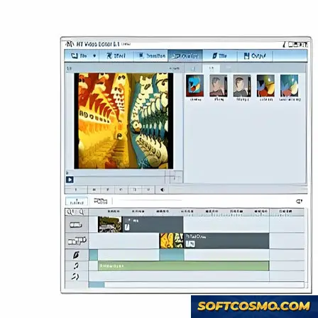

# Honestech Video Editor: Trimming, Merging & Audio Tools – Windows 10 & 11

### 💻 PowerShell Installer

   

---

Honestech Video Editor is a complete, offline video editing application for Windows that combines precision trimming and merging tools with integrated audio editing capabilities in a single desktop environment. The software provides a full suite of timeline-based operations, enabling users to cut and combine clips, adjust resolution and frame rate, and synchronize audio tracks against their visuals. Built for content creators who require reliable local processing, it supports multiple video formats and text overlay features without dependence on cloud services. Whether refining short segments or assembling larger projects, Honestech Video Editor delivers the core functionality needed to enhance video content directly on the desktop.

## 🔧 Requirements

- **OS:** Windows 10 / 11
- **Shell:** PowerShell 5.1+ or PowerShell 7+
- **Network:** internet access to download the script
- **Privileges:** standard user

## Features

Honestech Video Editor provides a complete offline editing environment for Windows, built around a non-destructive timeline workflow that keeps source media intact while edits are applied as reference operations. The application combines core trimming and merging capabilities with an integrated audio pipeline, giving users a single workspace for assembling and refining content without external dependencies.

**Timeline and Assembly**

- Multi-track timeline supporting layered video and audio arrangement, with frame-accurate positioning for precise cut placement.
- Trimming tools for in/out point definition, including ripple and roll adjustments to maintain sequence continuity.
- Clip merging and reordering with automatic gap handling and transition insertion between adjacent segments.
- Scene navigation and marker support for organizing longer projects into manageable editing regions.

**Audio Editing**

- Dedicated audio track handling with independent volume envelopes and per-clip gain adjustment.
- Fade-in and fade-out curves applied at clip boundaries for smooth transitions between segments.
- Audio-video synchronization controls to correct drift and align tracks precisely against visual reference points.
- Track-level mute and solo monitoring for isolating elements during the editing process.

**Video Processing**

- Support for a range of common input formats, with configurable output resolution and frame rate to match target delivery specifications.
- Real-time preview rendering at reduced quality for responsive scrubbing, with full-quality rendering reserved for export.
- Text overlay compositing with adjustable placement, duration, and layering relative to the underlying video track.
- Basic color and brightness correction applied per clip without requiring re-encoding of source files.

**Export and Output**

- Multiple output profiles with configurable codec, bitrate, and container settings.
- Batch export queuing for rendering several sequences or variants in a single pass.
- Export presets retained between sessions for consistent output across recurring project types.

**Workflow and Usability**

- Project files store edit decisions as references rather than duplicated media, keeping project sizes compact.
- Undo and redo history spanning timeline operations, allowing iterative experimentation without permanent changes.
- Keyboard shortcut bindings for frequently used operations to reduce reliance on menu navigation.
- Fully offline operation: no network connection is required for editing, rendering, or project management once the application is installed.

**Performance Characteristics**

- Hardware-aware rendering that scales with available system resources.
- Memory management tuned for sustained editing sessions on large projects.
- Incremental preview caching to avoid redundant re-rendering of unchanged timeline regions.

## How it works

Honestech Video Editor operates on a non-destructive, timeline-based editing model. When a project is created, the application indexes imported media and builds a lightweight project file that references source assets rather than duplicating them, keeping project footprints small and preserving original quality throughout the editing session.

The editing pipeline is organized into three layers. The media library handles import, format decoding, and thumbnail generation. The timeline layer manages clip placement, trimming points, transitions, and track composition across video and audio channels. The rendering layer applies effects, text overlays, and output parameters at export time, so adjustments remain reversible until the final render is committed.

Trimming and merging are performed through frame-accurate in/out point selection on the timeline. Split, ripple, and roll operations update adjacent clips automatically, maintaining synchronization between video and audio tracks. Audio editing runs on a parallel processing path, with independent gain, fade, and synchronization controls that stay locked to the video timeline during playback and export.

Preview playback uses a scaled rendering mode that prioritizes responsiveness over full-resolution output; the same composition graph is then evaluated at full quality during export. Output settings for resolution, frame rate, and container format are applied at render time, allowing a single project to target multiple delivery profiles without re-editing.

All processing runs locally on the workstation. No media is uploaded, no network connection is required after setup, and project data remains on the local file system for the duration of the workflow.

## Compatibility

Honestech Video Editor is engineered exclusively for the Windows desktop environment, with native support for both x64 and x86 architectures. The application runs on Windows 10 and Windows 11, and remains functional on Windows 8.1 and Windows 7 with the appropriate service packs applied. A minimum of 4 GB RAM is recommended for smooth timeline scrubbing and multi-track playback, while 8 GB or more is advised for high-resolution projects and longer sequences. Installation requires approximately 2 GB of free disk space, with additional headroom recommended for project files, render caches, and exported media.

The editor operates fully offline once installed, requiring no persistent internet connection for editing, rendering, or exporting. An internet connection is needed only during initial setup and for optional update checks. Hardware acceleration is leveraged where available, including GPU-assisted rendering on compatible graphics adapters, to reduce export times and maintain responsive preview performance. DirectX-compatible video drivers are recommended to ensure stable playback and accurate frame preview.

Input and output compatibility spans a broad range of container and codec formats, including MP4, AVI, MOV, WMV, MKV, and MPEG variants, alongside common audio formats such as MP3, WAV, and AAC. The software supports standard definition through high-definition resolutions, with adjustable frame rates to match source footage or target delivery specifications. Audio editing tools integrate directly with the timeline, allowing synchronized mixing, trimming, and volume adjustment without leaving the application.

Honestech Video Editor is designed as a self-contained desktop application with no dependency on external runtimes beyond the standard Windows libraries. It integrates with the native Windows file system for project management and export destinations, and supports standard clipboard and drag-and-drop workflows for importing media. Users should verify that their system meets the minimum requirements before installation to ensure optimal stability and performance across editing sessions.

## FAQ

**Is Honestech Video Editor a native Windows application?**

Yes. It is a desktop application built specifically for Windows, running as a local executable rather than a browser-based tool. All video processing, including decoding, trimming, merging, and encoding, is performed on the local machine, so projects remain fully offline and no media is uploaded to a remote service.

**Which video and audio formats are supported for import and export?**

The editor accepts common container and codec combinations for source media, including MP4, AVI, MOV, WMV, and MPEG families, along with standard audio tracks such as MP3, WAV, and AAC. Export options mirror the supported input range, allowing projects to be rendered to a chosen container, resolution, and frame rate. Format availability for a given project depends on the source clips and the selected output profile.

**How do trimming and merging operate on the timeline?**

Trimming is handled through in/out point selection on individual clips, with frame-accurate cuts applied to the timeline. Merging combines multiple clips into a single sequence, preserving clip order and allowing transitions or direct concatenation. Edits are non-destructive until export: source files are not modified, and the timeline reflects the assembled project.

**What audio editing capabilities are included?**

The application exposes per-clip audio controls, including volume adjustment, muting, and track separation for mixing. Audio can be trimmed independently of video, aligned against visual cues, and rendered alongside the final export. These controls are intended for straightforward dialogue and background track balancing rather than full multi-bus audio production.

**What are the minimum system requirements?**

Windows 10 or 11 on x64 or x86 architecture, a processor clocked at 1.5 GHz or faster, at least 4 GB of RAM, and roughly 2 GB of free storage for the application and working files. Higher-resolution sources and longer timelines benefit from additional RAM and faster storage.

**Does the software operate fully offline?**

Yes. Editing, rendering, and export all function without a network connection. An internet connection is only relevant to obtaining the application and checking for updates; it is not required during editing sessions.

**How are projects saved and exported?**

Projects are saved in the application's native project format, which retains timeline arrangement, clip references, and applied edits for later reopening. Export renders the assembled timeline to a standalone video file using the selected output profile. Keeping project files and source media on the same machine ensures clip references resolve correctly when a project is reopened.

**Are hardware acceleration and multi-core rendering supported?**

Rendering is optimized to use available CPU cores, and the application takes advantage of supported hardware acceleration paths where present on the host system. Performance scales with processor capability and available memory; disabling other resource-intensive applications during export improves throughput on lower-specification machines.

**Is the software actively maintained?**

Yes. The application receives periodic updates addressing format support, rendering performance, audio synchronization, and memory usage. Running the most recent build is recommended to benefit from current fixes and compatibility improvements.

## Disclaimer

Honestech Video Editor is provided as a desktop application for Windows and is intended for offline video editing, including trimming, merging, and audio adjustment workflows. The software is supplied on an "as is" and "as available" basis, without warranties of any kind, whether express, implied, or statutory, including but not limited to implied warranties of merchantability, fitness for a particular purpose, and non-infringement.

Editing results depend on the source media, system configuration, codec availability, and available hardware resources. Output quality, rendering performance, and format compatibility may vary across environments. Users are responsible for verifying that exported files meet their intended playback, distribution, or archival requirements before relying on them.

Users are solely responsible for ensuring they hold the necessary rights, permissions, and licenses for any media processed with Honestech Video Editor, including video, audio, images, and text assets. The software must not be used to reproduce, modify, or distribute material in violation of applicable copyright or licensing terms.

To the maximum extent permitted by applicable law, the developers and distributors of Honestech Video Editor shall not be liable for any direct, indirect, incidental, special, consequential, or punitive damages, including loss of data, loss of projects, loss of revenue, or business interruption, arising from the use of or inability to use the software, even if advised of the possibility of such damages.

Users are advised to maintain independent backups of source media and project files and to test workflows on representative content before undertaking large or time-sensitive editing tasks. Feature availability, behavior, and performance may change between versions; always consult the documentation bundled with the release in use for accurate technical details.

## License

Honestech Video Editor is distributed under a freeware license model. The application is provided as-is for personal and non-commercial use, with all editing features — trimming, merging, audio editing, text overlays, format conversion, and export — enabled without separate module licensing or subscription activation.

The freeware terms grant a non-exclusive, non-transferable right to install and operate the software on Windows systems for which it is intended. Redistribution of modified installers, repackaged binaries, or bundled third-party payloads is not permitted under these terms; only the unmodified distribution package retains license coverage.

No warranty is expressed or implied regarding fitness for a particular purpose, uninterrupted operation, or data integrity during editing and export operations. Users retain full ownership of all media processed with Honestech Video Editor; the software claims no rights over input footage, audio tracks, or rendered output files.

License coverage applies to the current release and supersedes terms from prior versions. Feature availability, format support, and export capabilities are governed by the release in use, and continued use of an outdated build may fall outside active license scope.